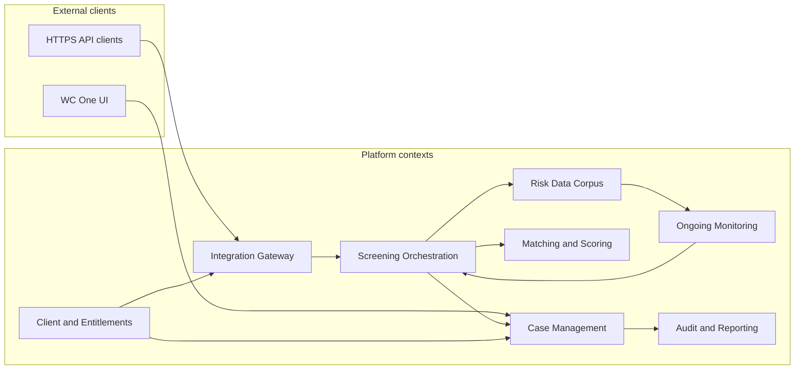

# World-Check context map (living document)

| Field | Value |
|-------|--------|
| **Version** | 0.1 |
| **Last updated** | YYYY-MM-DD |
| **Author** | |
| **Validated with** | [Engineers, product — names] |

## Purpose

Strategic DDD map: **bounded contexts**, relationships, and integration styles. Update after workshops and major RFCs.

## Legend (relationship types)

| Symbol | Meaning |
|--------|---------|
| **CF** | Customer-Supplier (upstream/downstream) |
| **OHS** | Open Host Service (published language / API) |
| **ACL** | Anti-Corruption Layer |
| **SK** | Shared Kernel (minimise — document why) |
| **Conformist** | Downstream accepts upstream model |
| **PL** | Published Language (e.g. public OpenAPI) |

## Context inventory

| Context | Responsibility (one sentence) | Owning team | Primary store | Public API? |
|---------|------------------------------|-------------|---------------|-------------|
| Screening Orchestration | Execute sync/async screen against providers | | | |
| Case Management | Case lifecycle, matches, remediation workflow | | | |
| Matching & Scoring | Algorithms, thresholds, explainability | | | |
| Risk Data Corpus | Ingestion, enrichment, versioning of lists/media | | | |
| Ongoing Monitoring | Rescreen triggers, backlog processing | | | |
| Batch Screening | Large file / scheduled jobs | | | |
| Client & Entitlements | Groups, users, API keys, product features | | | |
| Audit & Reporting | Immutable history, exports, case reports | | | |
| Integration Gateway | External HTTPS API, auth, rate limits | | | |
| Identity Verification | IDV integrations (if separate) | | | |

*Replace rows with your estate; delete unused.*

## Diagram (Mermaid)

Edit as you learn real boundaries:

## Integration matrix

| From → To | Style | Sync/Async | Contract location | Notes |
|-----------|-------|------------|-------------------|-------|
| Gateway → Screening | REST | Sync | OpenAPI v__ | |
| Screening → Case | REST / events | | | |
| Data → Monitoring | Events | Async | Schema registry topic | |
| Case → Audit | Events / DB | | | Immutable |

## Hotspots and questions

| # | Boundary tension | Question for leads | Resolution |
|---|------------------|-------------------|------------|
| 1 | Screening vs Case — who owns match persistence? | | |
| 2 | Matching version rollout vs case replay | | |

## Change log

| Date | Change |
|------|--------|
| | v0.1 initial |
